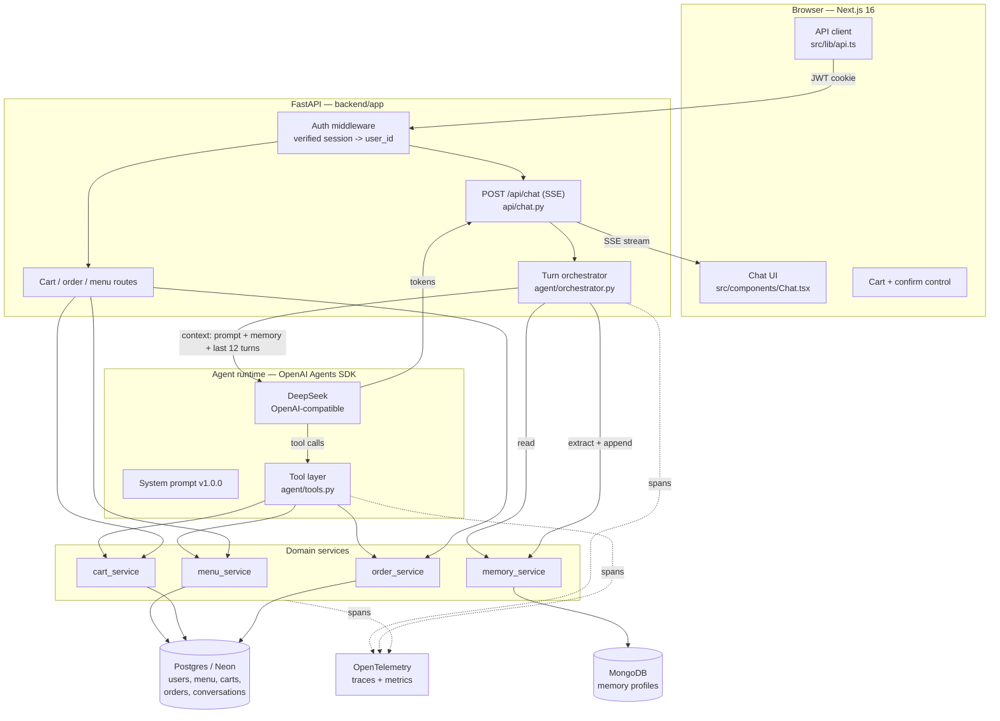
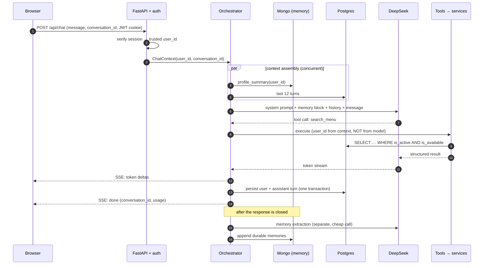

# Architecture

**Version:** 1.0.0 · Target state for v1. Where this differs from the current scaffold, the
difference is called out with the file that changes.

---

## 1. System shape

**The one-line summary:** the browser talks only to FastAPI; FastAPI owns identity and state; the
LLM is a component *inside* the request, never a peer of the database. Tools reach the database
through domain services that enforce the rules in [DOMAIN_MODEL.md](DOMAIN_MODEL.md) — the model
never gets a data path that bypasses them.

---

## 2. Layers and what each may do

| Layer | Files | May do | May **not** do |
| --- | --- | --- | --- |
| Route | `app/api/*.py` | Validate input, resolve session → `user_id`, call orchestrator/services, shape responses | Contain business rules, touch the DB directly |
| Orchestrator | `app/agent/orchestrator.py` *(new)* | Assemble context, run the agent, stream, persist the turn, trigger memory extraction | Contain menu/cart/order rules |
| Agent runtime | `app/agent/restaurant_agent.py` | Own the prompt, model config, tool registration | Read or write storage directly |
| Tool layer | `app/agent/tools.py` | Translate model arguments → service calls, return structured results | Contain business rules; trust any id supplied by the model as an owner |
| Domain services | `app/services/*.py` *(new)* | Enforce every rule and invariant in the domain model; own transactions | Know about HTTP, prompts, or the LLM |
| Repositories | `app/db/*.py` | Query and persist | Contain business rules |

**Dependency rule:** dependencies point downward only. A domain service must be testable with no
FastAPI and no LLM — which is what makes the unit tier in
[TEST_STRATEGY.md](TEST_STRATEGY.md) §3 possible.

**Scaffold delta.** Today `app/agent/tools.py` writes to Mongo directly and holds ordering logic.
M1–M3 extracts `app/services/` beneath it; tools become thin adapters.

---

## 3. Anatomy of a turn

**Point 4 is the trust boundary.** `user_id` enters the tool layer through the Agents SDK run
context, never as a model-supplied argument. The scaffold already does this correctly —
`RunContextWrapper[ChatContext]` in `backend/app/agent/tools.py` — and this is the pattern every new
tool must follow (BC-4, KPI A03).

**Step 15 is off the critical path.** Memory extraction is a second LLM call; running it before the
response closes would add ~1 s to every turn and blow KPI P02. It runs after the stream completes,
and its failure is swallowed (already the behaviour of `extract_memory` in
`app/agent/restaurant_agent.py`).

---

## 4. Context assembly

Assembled in this exact order every turn. Order is fixed because it determines what the model
weights most and what gets truncated first.

| # | Block | Source | Budget |
| --- | --- | --- | --- |
| 1 | System prompt v1.0.0 | Static, versioned | ~900 tok |
| 2 | Memory block | Mongo profile, rendered as **quoted data** | ≤ 300 tok |
| 3 | Conversation history | Last 12 turns from Postgres (Rule V3) | ≤ 2 000 tok |
| 4 | Current user message | Request | ≤ 500 tok |
| 5 | Tool schemas | Agents SDK, from tool signatures | ~700 tok |

**Total budget: 4 000 prompt tokens p95** — KPI C02. Enforced by truncating block 3 oldest-first;
blocks 1, 2, and 5 are never truncated. Every turn's actual counts land on the span
(`llm.prompt_tokens`) so the budget is monitored, not assumed
([OBSERVABILITY.md](OBSERVABILITY.md) §3).

Blocks 2 and 3 contain user-authored text and are wrapped in explicit data delimiters with a
standing instruction that content inside is never an instruction (BC-5).

---

## 5. Streaming

v1 uses **Server-Sent Events**, not WebSockets ([ADR-0003](adr/0003-sse-over-websocket.md)).
The traffic is one-directional (server → client tokens); the request that starts it is an ordinary
POST. SSE gives automatic reconnection and passes through proxies without upgrade negotiation.

Event types on `POST /api/chat`: `token` (text delta), `tool` (name + phase, so the UI can show
"checking the menu…"), `cart` (updated cart snapshot after a mutation), `done` (conversation id,
usage, cost), `error` (stable code + message). Contract in
[API_CONTRACT.md](API_CONTRACT.md) §4.

**Scaffold delta.** `app/api/chat.py` is currently request/response, which cannot meet the
time-to-first-token KPI (P01) — a full DeepSeek completion takes seconds. M3 converts it.

---

## 6. Failure matrix

What degrades versus what fails, decided deliberately rather than by whatever the exception happens
to do. Each row has a fault-injection test named in [TEST_STRATEGY.md](TEST_STRATEGY.md) §6.

| Dependency down | Behaviour | HTTP | KPI |
| --- | --- | --- | --- |
| **MongoDB** (memory) | **Degrade.** Chat proceeds with an empty memory block; extraction skipped; warning logged, `degraded.memory` span attribute set | 200 | R06 |
| **Postgres** (state) | **Fail.** No history, no cart, no orders — a chat without them is unsafe, not merely worse | 503 `STORAGE_UNAVAILABLE` | R02 |
| **LLM** timeout/5xx | Retry 2× with jittered backoff (1 s, 3 s); then a fixed apology and a "try again" affordance. Never a fabricated reply | 200 with `error` event | R03 |
| **LLM** rate-limited | Same retry path; surface a "busy right now" message | 200 with `error` event | R03 |
| **One tool** raises | Return a structured error *to the model*, which reports it honestly (BC-7). Turn continues | 200 | R04, A02 |
| **Menu empty/unreachable** | Agent states it cannot reach the menu; names no items (US-26) | 200 | A02 |
| **Confirmation token invalid** | `confirm_order` refuses; agent asks to re-confirm. Never bypassed | 200 | A01 |

**Non-negotiable:** no failure path may result in the agent inventing data. Degradation is always
visible to the customer.

---

## 7. Concurrency and consistency

- **Cart mutations** take a row-level lock on the cart (`SELECT … FOR UPDATE`) and bump
  `cart_version`. Two devices editing one cart cannot interleave into a wrong quantity.
- **Order confirmation** is one transaction: validate token → validate availability → snapshot lines
  → insert order + lines + event → clear cart → consume token. Any failure rolls the whole thing
  back (Rule R1, INV-8).
- **Idempotency:** `confirm_order` and `cancel_order` accept an idempotency key; a replay returns the
  original result rather than a second order. This matters because a network retry on a confirm is
  exactly the scenario KPI R05 forbids getting wrong.
- **Conversation writes** are append-only; a turn's user and assistant messages are written together.

---

## 8. Configuration and environments

Config is environment variables only, typed through the existing `Settings` in `app/config.py`
(extended with auth, OTel, tax rate, and cancellation-window settings). No secret ever reaches the
frontend; the browser sees only `NEXT_PUBLIC_API_URL`.

| Env | Postgres | Mongo | LLM | Notes |
| --- | --- | --- | --- | --- |
| local | Docker | Docker | DeepSeek dev key | `docker compose up` |
| test/CI | ephemeral (testcontainers) | ephemeral | **fake** (recorded) | No network, no cost |
| eval-nightly | ephemeral | ephemeral | real DeepSeek | Cost-capped |
| staging | Neon branch | Atlas | real | Mirrors prod |
| production | Neon | Atlas | real + fallback model | |

**Scaffold delta.** `init_db()` calling `Base.metadata.create_all` in `app/db/postgres.py` is
dev-only. From M1 the schema is owned by Alembic ([DATA_MODEL.md](DATA_MODEL.md) §7); `create_all`
is deleted so a migration can never be skipped.

---

## 9. Security posture

Detail in [AUTH_SPEC.md](AUTH_SPEC.md); the architectural commitments:

1. **Identity never comes from the model.** Verified session → `ChatContext` → tools (§3).
2. **Authorization at the service layer**, not the route layer — a tool cannot reach a query that
   forgot the owner filter, because ownership is a required argument of every service method.
3. **All model-adjacent text is data.** Menu descriptions, item names, memory entries, and prior
   turns are delimited and never promoted to instructions (BC-5).
4. **Least privilege at the tool boundary.** There is no generic "run SQL" tool and never will be;
   each tool exposes one narrow, validated operation.
5. **Secrets** come from the environment; none are logged. Log redaction is specified in
   [OBSERVABILITY.md](OBSERVABILITY.md) §4.

---

## 10. Performance design

The KPIs (P01–P06 in [KPIS.md](KPIS.md)) are met by four decisions, not by later tuning:

1. **Stream** — TTFT is decoupled from full generation (§5).
2. **Bounded context** — 12 turns, 4 k tokens; prompt size cannot grow with conversation length (§4).
3. **Concurrent context assembly** — the Mongo memory read and the Postgres history read run
   together (§3, step 3); no serial round-trip stacking.
4. **Memory extraction off the critical path** (§3, step 15).

Everything else is ordinary: connection pooling, the indexes in [DATA_MODEL.md](DATA_MODEL.md) §5,
and an in-process TTL cache (60 s) for the menu, which is read on nearly every turn and changes
rarely.

**Explicitly not doing** in v1: a caching layer for LLM responses, a vector store, or a queue.
None are needed to hit the targets, and each would add a failure mode.
