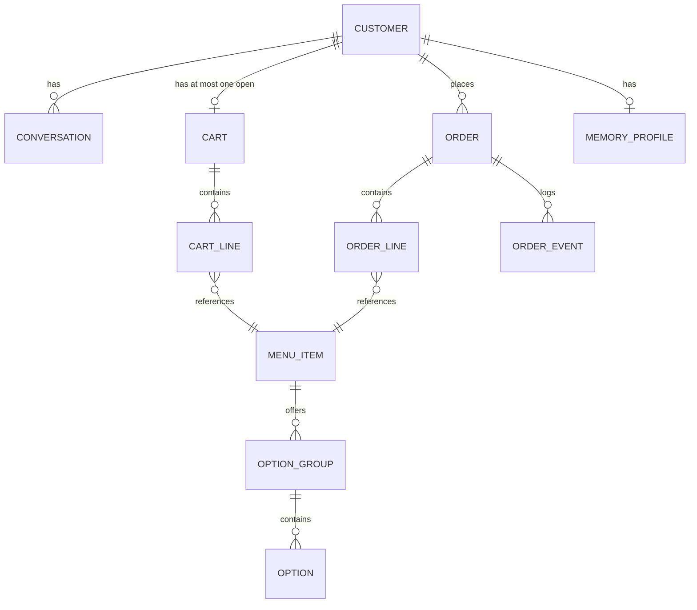
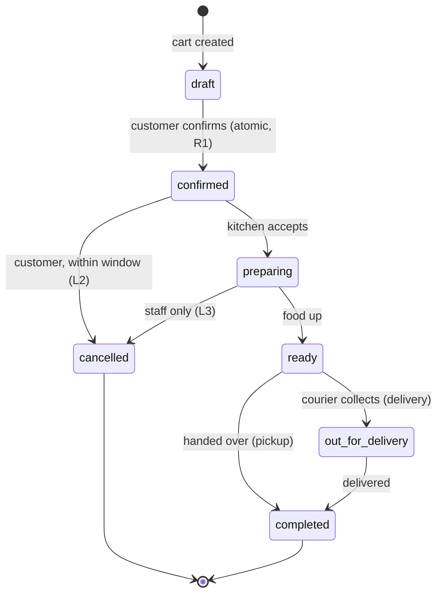

# Domain Model

**Version:** 1.0.0 · Technology-free by design.

This is the single source of truth the schema ([DATA_MODEL.md](DATA_MODEL.md)), the tool catalog
([AGENT_SPEC.md](AGENT_SPEC.md)), and the eval fixtures ([EVAL_PLAN.md](EVAL_PLAN.md)) all derive
from. If a rule here changes, those three change with it. No business rule may live *only* in a
prompt.

---

## 1. Entities

### Customer
A person with an account. Identified by a stable `customer_id` issued at registration. **Every**
cart, order, conversation, and memory belongs to exactly one customer, and identity is always taken
from the verified session — never from anything the model produced (BC-4).

### Menu item
| Attribute | Rule |
| --- | --- |
| `id` | Stable, never reused, safe to speak aloud |
| `name` | Unique within the active menu (so "the pizza" ambiguity is a *category* problem, not an id problem) |
| `description` | Customer-facing prose. **Untrusted content** — treated as data, never instructions (BC-5) |
| `category` | Exactly one: Starters, Pizza, Pasta, Salad, Sides, Dessert, Drinks |
| `base_price` | Positive, in minor units (cents). Never a float — see §4 |
| `dietary_tags` | Zero or more of: `vegetarian`, `vegan`, `gluten_free`, `halal`, `spicy` |
| `allergens` | Zero or more of: `peanut`, `tree_nut`, `dairy`, `egg`, `gluten`, `soy`, `shellfish`, `fish`, `sesame` |
| `is_available` | Today's availability ("86'd"). Independent of soft-delete |
| `is_active` | Soft delete. Inactive items stay referenced by historical orders but never appear in search |

**Rule M1.** An item is offerable iff `is_active AND is_available`.
**Rule M2.** `dietary_tags` and `allergens` are independent. An item may be `vegetarian` and still
contain `peanut`. Never infer one from the other — this is a safety rule, not a convenience.
**Rule M3.** Allergen data absent ≠ allergen free. If an item's allergen list is unverified, the
agent must say so rather than assert safety.

### Option group and option
A menu item may offer option groups (e.g. "Size", "Extra toppings"). A group has `min_select` and
`max_select`; an option carries a `price_delta` (may be zero or negative).

**Rule O1.** A cart line is valid only if, for every group on its item, the number of chosen options
is within `[min_select, max_select]`.
**Rule O2.** Line unit price = item `base_price` + sum of chosen `price_delta`s.

*v1 note:* the seeded menu uses at most one option group per item. The model supports more so the
schema does not need to change later.

### Cart
A mutable, unconfirmed collection of lines. **At most one open cart per customer** — this is what
makes "add the pizza" resolvable across turns and across devices.

| Attribute | Rule |
| --- | --- |
| `lines` | Zero or more cart lines |
| `updated_at` | Bumped on every mutation |
| `confirmation_token` | See §3. Null unless a read-back has just occurred |

**Rule C1.** A cart line is `(menu_item, chosen_options, quantity, note)`. Two lines with identical
item *and* options merge into one with summed quantity; differing options stay separate lines.
**Rule C2.** `quantity` is an integer in `[1, 20]`. Zero means "remove the line", never "keep a line
of zero". Above 20 requires the customer to confirm explicitly (guards a mis-parsed "fifteen" →
"fifty").
**Rule C3.** An unavailable item cannot be added. If an item becomes unavailable *while* in a cart,
confirmation fails and the customer is told which line is the problem.
**Rule C4.** A cart untouched for 24 h is abandoned and cleared.

### Order
An immutable record of what the customer committed to. Created only by confirming a cart.

**Rule R1.** Confirming a cart is a single atomic transaction: snapshot every line *with the prices
current at that moment*, write the order, empty the cart. Partial state is never observable.
**Rule R2.** An order stores **price snapshots**, not references to live prices. A later menu price
change never alters a placed order.
**Rule R3.** Order ids are customer-speakable (`ORD-` + 6 digits), unique, and **not sequential** —
sequential ids would let one customer guess another's (BC-4).
**Rule R4.** A confirmed order is never deleted. Cancellation is a state change plus an event.

### Order event
An append-only log of every state transition: `(order, from_status, to_status, actor, reason, at)`.
`actor` is `customer`, `staff`, or `system`. This is the audit trail behind KPI R05 ("confirmed
orders lost = 0") and the source for status history.

### Memory profile
Durable, per-customer knowledge. Two kinds:

- **Preferences** — dispositions that shape suggestions: "vegetarian", "likes spicy food", "usually
  orders the Margherita".
- **Facts** — stable personal details: preferred name, allergies, default delivery notes.

**Rule N1 (durability).** Store only what would still be true next month. A one-off ("a Coke for my
friend today") is not durable (US-23).
**Rule N2 (never store).** Payment details, government identifiers, precise location, and free-text
health data beyond declared food allergies (BC-6).
**Rule N3 (allergy supremacy).** A recorded allergy always overrides a preference or a suggestion.
It may never be silently dropped, and removing one requires an explicit customer action.
**Rule N4 (visibility).** Every stored memory is viewable and deletable by its owner (US-24).
**Rule N5 (data, not instruction).** Memory text is injected into the prompt as quoted data and can
never be executed as an instruction (BC-5).

---

## 2. Order lifecycle

**Rule L1.** Transitions occur only along the arrows above. Any other transition is rejected and
logged as an integrity error, never silently coerced.
**Rule L2 (cancellation window).** A customer may cancel while status is `confirmed` **and** less
than **10 minutes** have elapsed since confirmation. Outside that, the agent must decline honestly
and offer to contact the restaurant (US-20).
**Rule L3.** From `preparing` onward only staff may cancel. The agent never can.
**Rule L4.** `completed` and `cancelled` are terminal.
**Rule L5.** Every transition writes an order event (§1) in the same transaction as the status
change.

*v1 note:* `preparing → ready → completed` are advanced by an internal ops endpoint or seed script,
not by a real kitchen system.

---

## 3. The confirmation protocol

The core safety mechanism behind BC-2 and KPI A01. Stated here because it is a business rule, not an
implementation detail.

1. The customer signals they are finished.
2. The system produces a **read-back**: every line, its quantity, its unit price, and the
   system-computed total. The read-back is generated from stored cart state — the agent never
   composes the numbers itself (BC-3).
3. The read-back issues a **confirmation token** bound to `(cart_id, cart_version, customer_id)`,
   valid for **5 minutes**.
4. An order can be created only by presenting a valid, unexpired, unused token.
5. **Any** cart mutation increments `cart_version`, which invalidates every outstanding token
   (US-15). A changed cart always requires a fresh read-back.
6. Tokens are single-use.

The consequence that matters: a model that decides to place an order on its own *cannot*, because it
has no valid token. The guarantee is structural, not persuasive.

---

## 4. Money

**Rule $1.** All money is integer **minor units** (cents). No floating point anywhere — not in the
database, not in the API, not in tool arguments. Floats are permitted only at the final display
boundary in the frontend.
**Rule $2.** Line total = `unit_price × quantity`, computed as integers.
**Rule $3.** Order subtotal = sum of line totals. Tax = `round_half_up(subtotal × tax_rate)`, applied
to the **subtotal**, not per line, then the total = subtotal + tax + delivery fee.
**Rule $4.** Rounding is half-up, once, at the tax step. Every other operation is exact.
**Rule $5.** A total is authoritative only when it comes from the system. Any total the agent utters
must be a verbatim echo of a tool result (BC-3).
**Rule $6.** v1 uses a single currency and a single flat `tax_rate` from configuration.

---

## 5. Conversation

**Rule V1.** A conversation is an ordered sequence of turns belonging to one customer.
**Rule V2.** Only customer and agent messages are persisted as conversation content. Tool calls and
results are persisted as *telemetry* (spans), not replayed as conversation text — this bounds prompt
growth (KPI C02).
**Rule V3.** The agent's working context is the last **N = 12** turns. Anything older survives only
if promoted to memory. Rationale: the token budget in [KPIS.md](KPIS.md) KPI-C02.
**Rule V4.** A conversation may span multiple carts and orders over time.
**Rule V5.** Cart and order state — never the transcript — is the source of truth for what was
ordered. If the transcript and the cart disagree, the cart wins.

---

## 6. Invariants

The properties that must hold at all times. Each is checkable, and each has a test named in
[TEST_STRATEGY.md](TEST_STRATEGY.md) §3.

| ID | Invariant |
| --- | --- |
| INV-1 | Every cart line references an item that was active when added |
| INV-2 | Cart line quantity ∈ [1, 20] |
| INV-3 | At most one open cart per customer |
| INV-4 | Order total == Σ line totals + tax + fee, recomputed from stored snapshots |
| INV-5 | Every order has ≥ 1 line |
| INV-6 | Every order status change has a matching order event |
| INV-7 | Order status transitions follow §2 only |
| INV-8 | No order exists without a consumed, valid confirmation token |
| INV-9 | Every cart, order, conversation, and memory row has a non-null owner |
| INV-10 | A memory profile never contains a denied category (Rule N2) |

---

## 7. Glossary

**86'd** — unavailable today (`is_available = false`). · **Read-back** — the itemised recital that
precedes confirmation (§3). · **Cancellation window** — the 10 minutes after confirmation during
which a customer may cancel (L2). · **Durable memory** — knowledge that outlives the conversation
(N1). · **Snapshot pricing** — an order records prices as they were at confirmation (R2). ·
**Hard gate** — a KPI whose violation blocks merge ([KPIS.md](KPIS.md) §2).
