# Roadmap

**Version:** 1.0.0

A milestone is complete when **its numbers hold**, not when its code is written. Every exit
criterion below is a KPI from [KPIS.md](KPIS.md) or a named test from
[TEST_STRATEGY.md](TEST_STRATEGY.md).

---

## Sequencing

```mermaid
gantt
    dateFormat X
    axisFormat %s
    section Foundation
    M0 Foundations      :m0, 0, 3
    M1 Data & menu      :m1, after m0, 4
    M2 Auth             :m2, after m1, 4
    section Agent
    M3 Agent v1         :m3, after m2, 6
    M4 Eval + CI gates  :m4, after m3, 4
    section Product
    M5 Frontend v1      :m5, after m3, 5
    M6 Hardening        :m6, after m4, 4
```

Units are relative effort, not calendar days — sizing depends on the team.

**Why this order.** M4 (evals) comes *after* M3 rather than before, because eval cases assert against
tools that must exist first; the tradeoff is that M3 is developed against a manual smoke set and its
exit gate is provisional until M4 makes it enforceable. M5 runs parallel to M4 — the frontend needs
M3's streaming API, not the eval harness. Auth precedes the agent because retrofitting identity into
tool signatures is exactly the rework this plan exists to prevent.

---

## M0 — Foundations

Nothing product-visible. Everything after it depends on this being right.

**Work**
- **Consolidate the repository.** `backend/` and `frontend/` each contain their own `.git` from
  scaffolding (`uv init` and `create-next-app`). Remove both, `git init` at the root, one commit
  history. *Do this before any other work* — nested repos silently swallow commits.
- CI: lint, types, unit, build, on every push ([TEST_STRATEGY.md](TEST_STRATEGY.md) §10).
- Alembic; **delete `Base.metadata.create_all`** from `backend/app/db/postgres.py`.
- `docker compose` for Postgres, Mongo, OTLP collector.
- Extend `Settings` in `app/config.py` with auth, OTel, tax rate, cancellation window; refuse to boot
  on missing production secrets.
- OTel skeleton: root span per request, trace id in `X-Request-Id`.
- `ruff`, `mypy --strict` on `app/`, `eslint`, `tsc --noEmit`.
- `CONTRIBUTING.md`, PR template requiring the eval scorecard once M4 lands.

**Exit:** single git repo · CI green on both apps · `alembic upgrade head` works on a blank DB and
`alembic check` passes (R09) · traces visible locally · `mypy --strict` clean.

---

## M1 — Data and menu

**Work**
- Full Postgres schema from [DATA_MODEL.md](DATA_MODEL.md) §2 as the initial migration.
- `backend/seeds/menu.yaml`; `python -m app.cli seed-menu`; **delete `app/agent/menu.py`**.
- Domain services: `menu_service`, `cart_service`, `order_service` — every method takes `user_id`
  first ([AUTH_SPEC.md](AUTH_SPEC.md) §5).
- Order state machine, cancellation window, confirmation tokens, money arithmetic.
- Mongo profile documents migrated to the object form ([DATA_MODEL.md](DATA_MODEL.md) §3).
- Unit tests for §3 of the test strategy; integration tests for INV-1…INV-10.
- Nightly invariant sweep job (R08).

**Exit:** R08 = 0 · P04 p95 ≤ 50 ms on seeded data · unit coverage ≥ 90% on `app/services/` · every
invariant has a passing test · confirm-atomicity test passes under injected mid-transaction failure.

---

## M2 — Auth

**Work**
- `users`, `oauth_accounts`, `sessions`; Argon2id; JWT access + rotating refresh in httpOnly cookies.
- Google OAuth with PKCE; email verification; password reset.
- Auth middleware → `request.state.user_id`; **remove `user_id` from `ChatRequest`** in
  `app/api/chat.py`; `/api/profile/{user_id}` → `/api/profile`.
- CSRF double-submit; rate limits ([API_CONTRACT.md](API_CONTRACT.md) §10).
- `tests/security/test_tenancy.py` — the parameterised sweep over every route and tool.
- Frontend auth routes; delete `useUserId` from `Chat.tsx`.

**Exit:** **A03 = 0** across the full tenancy sweep · every attack-posture test in
[AUTH_SPEC.md](AUTH_SPEC.md) §7 passes · refresh reuse revokes the family and alerts · no enumeration
oracle (response and timing) · no route reachable without an owner filter.

---

## M3 — Agent v1

**Work**
- Nine tools per [AGENT_SPEC.md](AGENT_SPEC.md) §5, as thin adapters over M1's services.
- System prompt `v1.0.0` in `app/agent/prompts/`, versioned and stamped on messages and spans.
- **Confirmation protocol** end to end: `view_cart` issues the token, `confirm_order` consumes it,
  mutations invalidate it, same-turn issue+consume rejected.
- Orchestrator: context assembly (12 turns, 4 k budget, concurrent memory+history reads), SSE
  streaming, turn persistence, post-response memory extraction.
- `POST /api/chat` converted to SSE; cart and order REST routes.
- Memory: confidence floor, deny-list, allergy supremacy, dedupe.
- Retry/backoff/fallback; the full failure matrix ([ARCHITECTURE.md](ARCHITECTURE.md) §6).
- Manual smoke set of ~20 conversations (provisional until M4).

**Exit:** A01 = 0 and A02 = 0 on the smoke set · A04 ≥ 97%, A05 ≥ 98% · P01 p95 ≤ 2.5 s ·
P03 p95 ≤ 150 ms · C02 p95 ≤ 4 000 tokens · degradation verified: Mongo down → chat still 200.

> These gates are provisional on the smoke set and become enforceable at M4. M3 does not ship to
> customers alone.

---

## M4 — Eval harness and CI gates

**Work**
- Harness: case loader, DB seeding per case, fake-LLM cassettes, live mode.
- ~120 cases across the ten families ([EVAL_PLAN.md](EVAL_PLAN.md) §2), including all 8 adversarial
  and all 8 fault-injection cases.
- All eleven scorers; `evals.gate` with the four failure conditions; PR comment renderer.
- `evals.trace_matrix` with bidirectional orphan detection.
- Online scorers on sampled production traffic → `agent.violations`
  ([OBSERVABILITY.md](OBSERVABILITY.md) §3).
- Nightly live run, cost-capped.

**Exit:** full suite runs per PR in < 6 min at zero cost · every HARD and GATE KPI computed and
enforced · a deliberately introduced regression is caught by `evals.gate` (test the gate itself) ·
C06 ≤ $3 · traceability matrix has zero orphans in either direction.

---

## M5 — Frontend v1

Parallel with M4 once M3's API is stable.

**Work**
- `<ChatSurface>` split; SSE consumption; tool indicators.
- `<CartPanel>` + `<ConfirmDialog>` — the deliberate order-placement path
  ([FRONTEND_SPEC.md](FRONTEND_SPEC.md) §4).
- `/menu`, `/orders`, `/orders/[id]`, `/profile` with memory management (US-24).
- Generated API types; constrained Markdown renderer; CSP.
- Accessibility pass; all four states for every surface.
- Playwright e2e including the keyboard-only order.

**Exit:** P07 LCP ≤ 2.0 s · P08 INP ≤ 200 ms · P09 ≤ 180 kB (all on the **Lighthouse mobile** preset)
· WCAG 2.2 AA audit clean, including reflow (1.4.10) and target size (2.5.8) · every e2e flow in
[TEST_STRATEGY.md](TEST_STRATEGY.md) §8 passes, including the mobile trio and the 320–1440 px
breakpoint sweep in both themes · US-28…US-31 satisfied · no `dangerouslySetInnerHTML` on model
output (CI grep).

---

## M6 — Hardening

**Work**
- k6 at the standard profile; fix what it surfaces.
- Chaos suite ([TEST_STRATEGY.md](TEST_STRATEGY.md) §6) on staging, nightly.
- Dashboards and alerts wired; every page given a runbook entry.
- Daily order reconciliation (R05); cross-store deletion job verified.
- Security review: dependency audit, secret scan, tenancy re-verification, prompt-injection re-test.
- [RUNBOOK.md](RUNBOOK.md) rehearsed — someone other than the author performs each procedure.

**Exit:** P06 ≥ 50 concurrent with P01/P02 holding · R06 verified under chaos · R05 reconciliation
runs clean 7 consecutive days · every page has a runbook entry · security review closed with no
open high findings · PRD §8 release criteria all met.

---

## Post-v1

Sequenced by expected value, not by ease:

1. **Payments** (Stripe, webhooks, refunds) — the largest single scope, deferred deliberately.
2. **Kitchen display integration** — replaces the `/internal/orders/{id}/status` stand-in.
3. **Reservations.**
4. **Voice** (STT/TTS over the same agent).
5. **Multi-restaurant tenancy** — the schema already carries owner scoping; this adds a tenant axis.
6. **Proactive suggestions** ("your usual Friday order?").

Each requires its own PRD section, KPI additions, and eval families before implementation. The
process does not get skipped because the product is live.

---

## Build-readiness checklist

Every milestone must name a spec, a test approach, and an exit KPI. Any row missing one is an
incomplete spec — this table is itself a gate.

| Milestone | Spec | Test approach | Exit KPI |
| --- | --- | --- | --- |
| M0 | ARCHITECTURE §8, DATA_MODEL §7 | CI pipeline, `alembic check` | R09 |
| M1 | DOMAIN_MODEL, DATA_MODEL | Unit §3 + integration §4 | R08, P04 |
| M2 | AUTH_SPEC | Security §7 tenancy sweep | **A03** |
| M3 | AGENT_SPEC, API_CONTRACT, ARCHITECTURE | Smoke set + integration | A01, A02, A04, A05, P01, P03, C02 |
| M4 | EVAL_PLAN | Harness self-test (gate catches a seeded regression) | All HARD + GATE, C06 |
| M5 | FRONTEND_SPEC | e2e §8 + Lighthouse | P07, P08, P09 |
| M6 | OBSERVABILITY, RUNBOOK | Load §9 + chaos §6 | P06, R05, R06 |

---

## Risks

| Risk | Impact | Mitigation |
| --- | --- | --- |
| DeepSeek accuracy insufficient for A04/A05 | Blocks M3 | Prompt iteration first; then few-shot examples; then a stronger fallback model for tool-selection turns only. Decision point at M3 exit |
| Eval dataset too small to be sensitive | False confidence in the gates | Per-case regression detection (not just aggregates); every production bug adds a case |
| p95 latency dominated by the model | P01/P02 missed regardless of our work | P03 isolates our share; if the model is the cause, the options are a faster model or a UX that sets expectations — decided with data, not guesses |
| Memory precision below 90% | A08 gate fails; wrong personalisation | Confidence floor is tunable upward; worst case, memory becomes opt-in per fact |
| Scope creep into payments | Everything slips | Non-goals are explicit in PRD §3; adding them requires a PRD revision |
| Docs drift from code | Specs become fiction | Traceability matrix and `alembic check` in CI; each PR touching behaviour updates its spec |
